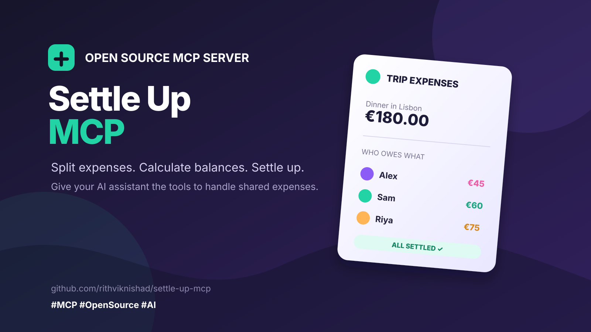

[](https://github.com/rithviknishad/settle-up-mcp/actions/workflows/docker.yml)

An MCP server for [Settle Up](https://settleup.io). It lets an AI agent read
and write your groups, members, expenses, balances, and recurring
transactions. The server gives 26 tools.

## Local Codex setup

See [the Windows Codex guide](docs/codex-local.md) for sandbox Google sign-in,
local server startup and Codex configuration. The helper saves the Firebase
session locally without manually copying tokens from browser storage.

## ChatGPT / OAuth support in this fork

See [the setup guide](docs/chatgpt.md) for ChatGPT web. This fork adds Google
OAuth with a required owner allowlist and accepts existing Settle Up Firebase
refresh tokens for accounts that sign in through Google.

MCP client authentication and the Settle Up Firebase session are independent.
This remains a single-account server.

**Startup change:** missing MCP credentials now stop startup. Static-token
clients retain `MCP_AUTH_MODE=token`. Anonymous tests must explicitly select
`MCP_AUTH_MODE=none` with a loopback listener. Google mode requires
`MCP_AUTH_MODE=google` and the settings in the guide.

Build this fork locally with `docker compose up --build -d`. The upstream
GHCR image mentioned below does not contain these changes.

## Tools

### Groups

| Tool | Action | Read-only |
|---|---|---|
| `settleup_list_groups` | Get your groups | Yes |
| `settleup_get_group` | Get the settings and the counts of 1 group | Yes |
| `settleup_get_balances` | Get who owes what in a group | Yes |
| `settleup_create_group` | Create a group and add yourself | No |
| `settleup_update_group` | Change the name or the settings | No |
| `settleup_get_invite_link` | Get the link that invites a person | No |
| `settleup_change_currency` | Change the group currency | No |
| `settleup_delete_group` | Delete a group. Needs `confirm` | No |

### Members

| Tool | Action | Read-only |
|---|---|---|
| `settleup_list_members` | Get the members of a group | Yes |
| `settleup_add_member` | Add a person to a group | No |
| `settleup_update_member` | Change a member | No |
| `settleup_deactivate_member` | Set a member to not active | No |

### Transactions

| Tool | Action | Read-only |
|---|---|---|
| `settleup_list_expenses` | Get the transactions of a group | Yes |
| `settleup_get_expense` | Get all details of 1 transaction | Yes |
| `settleup_summarize_spending` | Add the amounts by category, member, or month | Yes |
| `settleup_add_expense` | Add a new expense | No |
| `settleup_add_transfer` | Record a payment between 2 members | No |
| `settleup_update_expense` | Change a transaction | No |
| `settleup_delete_expense` | Delete a transaction. Needs `confirm` | No |

### Recurring transactions

| Tool | Action | Read-only |
|---|---|---|
| `settleup_list_recurring` | Get the transaction templates | Yes |
| `settleup_add_recurring` | Add a transaction template | No |
| `settleup_delete_recurring` | Delete a template. Needs `confirm` | No |

### History and access

| Tool | Action | Read-only |
|---|---|---|
| `settleup_list_changes` | Get the change log of a group | Yes |
| `settleup_list_categories` | Get the custom categories | Yes |
| `settleup_list_permissions` | Get who can access a group | Yes |
| `settleup_recalculate_debts` | Ask the server to calculate the debts again | No |

Caution: A tool with `confirm` deletes data. Ask the user first. Then set
`confirm` to true.

## Configuration

Copy `.env.example` to `.env`. Then write your values.

| Variable | Purpose |
|---|---|
| `SETTLEUP_EMAIL` | Email for password login; optional with a refresh token |
| `SETTLEUP_PASSWORD` | Password login only |
| `SETTLEUP_FIREBASE_API_KEY` | The Firebase Web API key |
| `SETTLEUP_BASE_URL` | The API server. The default is the sandbox |
| `SETTLEUP_REFRESH_TOKEN` | Firebase session for an existing OAuth account |
| `MCP_AUTH_MODE` | token (default), google, or explicit loopback none |
| `MCP_AUTH_TOKEN` | Required in token mode |

The [Settle Up API documentation](https://api.settleup.io) gives the API key,
the server URLs, and the sign-in rules. Develop on the sandbox first.

**Token mode requires MCP_AUTH_TOKEN.** For Google OAuth, follow the setup
guide above. Put HTTPS in front of any deployed server.

## Run it

```bash
docker compose up -d
curl http://localhost:8000/health
```

The MCP endpoint is `http://localhost:8000/mcp`. It uses the Streamable HTTP
transport.

To use a built image, pull `ghcr.io/rithviknishad/settle-up-mcp:latest`.

## Deploy it

Put the server behind HTTPS. Configure token or Google OAuth authentication.
Keep the Settle Up secrets on the server only.

For a Kubernetes example, read
[Settle Up MCP on systems.nix](https://rithviknishad.github.io/systems.nix/settle-up-mcp.html).
It shows a k3s deployment with the secrets, the service, and the ingress.

## Connect an agent

```json
{
  "mcpServers": {
    "settleup": {
      "url": "http://localhost:8000/mcp",
      "headers": { "Authorization": "Bearer YOUR_TOKEN" }
    }
  }
}
```

## Develop

This project needs Python 3.13, [Pipenv](https://pipenv.pypa.io), and
[direnv](https://direnv.net).

```bash
pipenv install --dev
direnv allow

pipenv run test      # Run the tests.
pipenv run server    # Start the server.
```

## Licence

MIT. See [LICENSE](LICENSE).
